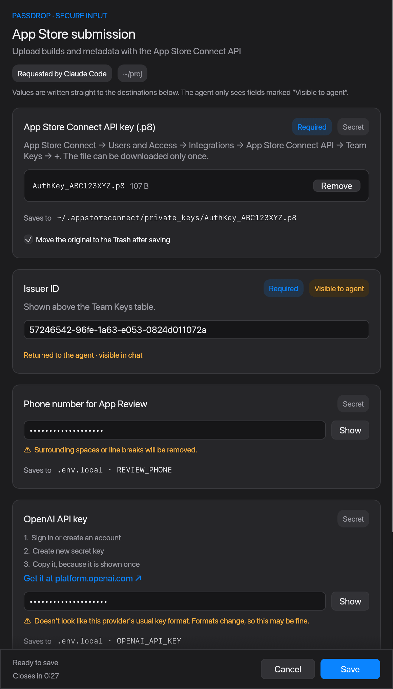

# passdrop

Let a coding agent ask you for secrets in a small native window. The values go straight
into your `.env` files or key paths and never enter the chat.



## Why

Agents like Claude Code and Codex regularly need an API key, a token or a `.p8` key file.
The usual answer is "paste it here", which puts the secret in the transcript and the model
context. With passdrop:

1. The agent writes a small JSON spec: which values it needs and where each one goes.
2. `passdrop request spec.json` opens a window. You type, paste or drag files in.
3. passdrop writes each value to its destination and gives the agent **one line of
   metadata**: what was created, kept or skipped, and where. Never the value.

Format checks (`sk-…`, UUIDs, PEM headers) only warn. Key formats change, and you decide.

## Install

macOS 11 or later, Apple silicon or Intel.

```bash
brew install akcware/tap/passdrop
```

Or build from source (Rust 1.93+):

```bash
cargo install --git https://github.com/akcware/passdrop passdrop
```

## Set up your agent

**Claude Code**, as a plugin:

```
/plugin marketplace add akcware/passdrop
/plugin install passdrop@passdrop
```

**Codex** (ChatGPT desktop app or Codex CLI), as a plugin:

```bash
codex plugin marketplace add akcware/passdrop
codex plugin add passdrop@passdrop
```

Then start a new Codex session. In the CLI you can also run `/plugins` and install
passdrop from the `passdrop` marketplace. Update it with
`codex plugin marketplace upgrade passdrop`, and remove it with
`codex plugin remove passdrop@passdrop`.

**Codex IDE extension, or any agent without plugins:**

```bash
passdrop init            # installs the skill for both; --claude or --codex for one
passdrop init --undo     # removes it
```

The plugins only add the skill, which tells the agent when to use passdrop and how to read
the result. You still need the CLI from Homebrew. Use either a plugin or `passdrop init`
for an agent, not both; otherwise it lists passdrop twice.

## What the agent does

```json
{
  "title": "OpenAI key",
  "x-purpose": "Call the OpenAI API from the dev server",
  "type": "object",
  "properties": {
    "openai_key": {
      "title": "OpenAI API key",
      "type": "string",
      "writeOnly": true,
      "x-sink": { "kind": "dotenv", "path": ".env.local", "key": "OPENAI_API_KEY" }
    }
  },
  "required": ["openai_key"]
}
```

```console
$ passdrop request spec.json
{"status":"ok","fields":{"openai_key":{"action":"created","ref":"env-file:.env.local#OPENAI_API_KEY","verified":true}},"next":"Values are in place. Do not read or print them; use them by reference."}
```

Because `OPENAI_API_KEY` is a well-known key, the window also shows where to get it.
`passdrop schema` prints the full spec format. [DESIGN.md](DESIGN.md) has the details.

**Destinations:**
- `dotenv`: edits only the target key's lines. New files are created with mode 600.
- `file`: writes the value or a dropped file to a path, owner-only. It can move the original
  to the Trash, but only when the dropped file looks like the expected one.

## What it protects, and what it doesn't

passdrop keeps secrets out of the chat, the transcript and the model context.

It also refuses to write to dangerous places: `~/.ssh`, `.git/`, `.github/`, agent config
folders and system directories. It never overwrites an existing value unless you choose
Replace.

It is **not** a wall between the agent and your disk. An agent with shell access can still
read `.env` afterwards. Pair passdrop with deny rules, for example in Claude Code:

```json
{ "permissions": { "deny": ["Read(**/.env)", "Read(**/.env.*)"] } }
```

`passdrop init` prints these suggestions and never changes your settings.

**Codex:** the window can't open inside Codex's sandbox. Approve the command when asked,
or allow it permanently with `prefix_rule(pattern=["passdrop"], decision="allow")` in
`~/.codex/rules/default.rules`.

## Development

```bash
cargo test --workspace                                   # 90+ tests
cargo test --workspace --features passdrop/test-harness  # + end-to-end and canary leak tests
claude plugin validate . --strict                        # plugin and marketplace manifests
```

`keychain`, `gh-secret` and `vercel-env` destinations exist on the `remote-sinks` branch.
They are not merged yet.

## License

MIT. The known-key registry is derived from
[tokenstash](https://github.com/krishhgg/tokenstash) (MIT); see
[THIRD_PARTY_NOTICES.md](THIRD_PARTY_NOTICES.md).
